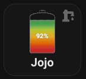
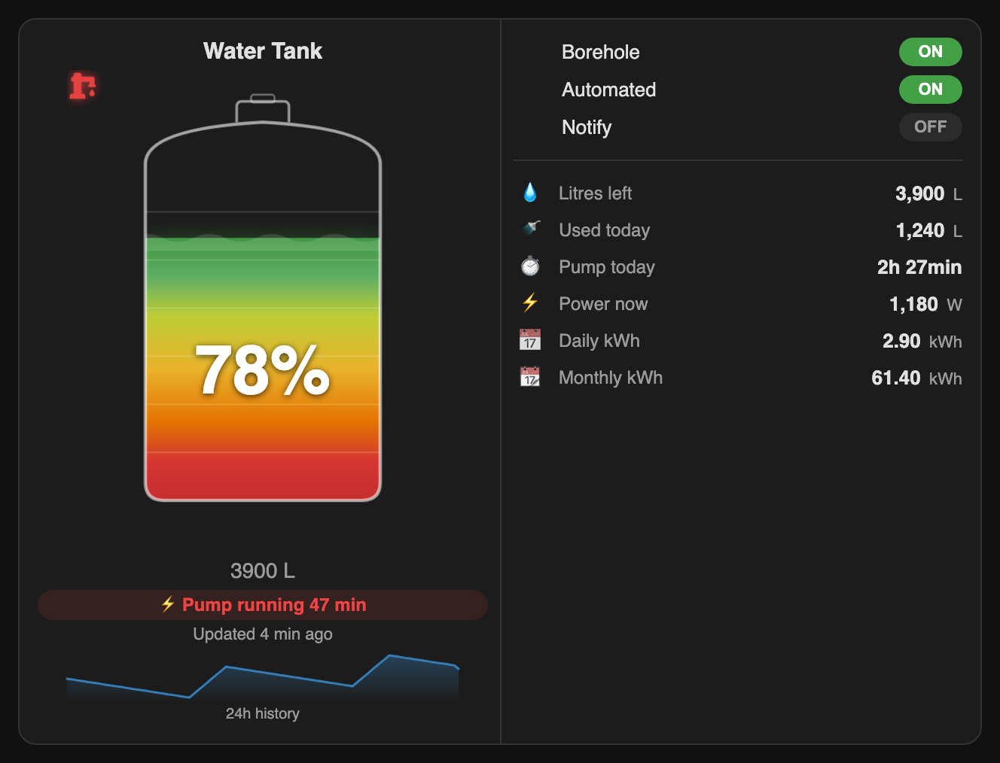

# Water Tank Card

 

Animated SVG water tank card for Home Assistant. Shows real-time fill level, pump status, capacity in litres, and a 24-hour history sparkline.

**Features at a glance:**
- Compact mode fits alongside standard button cards
- Medium (side-by-side) and full (stacked) modes with 24h history sparkline
- Live toggle buttons for switches, input_booleans, automations and more
- Visual config editor — no YAML needed
- Custom fill colour or automatic red→green gradient
- Pump toggle with confirmation dialog
- Adapts to light and dark HA themes

☕ Enjoying the card? [Buy me a coffee](https://buymeacoffee.com/hybridrcg)
